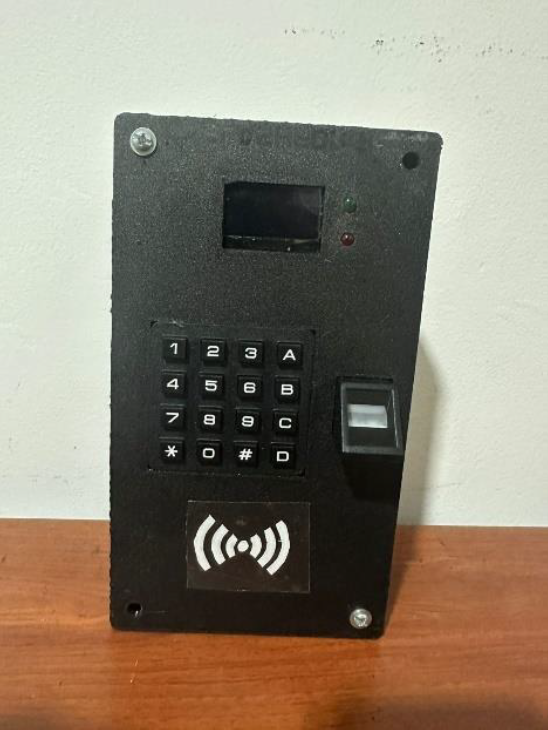
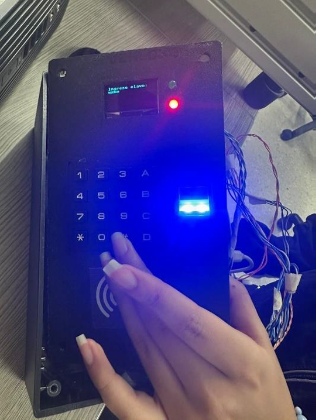
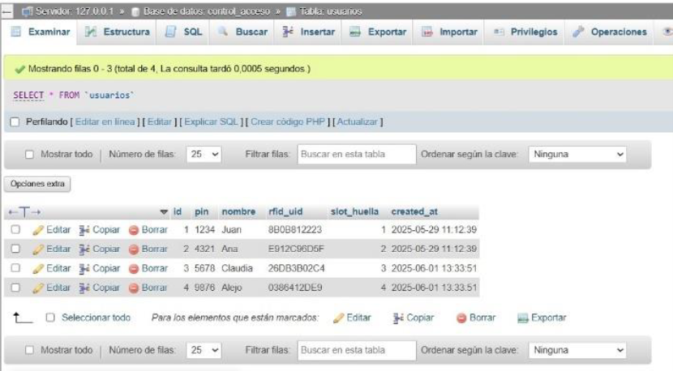

# Control-Access (ESP32 + MicroPython)

Multi-factor access control system built with an **ESP32** and **MicroPython**.  
The project combines **fingerprint (AS608)**, **RFID (RC522)**, and **PIN keypad (4×4)** authentication, and logs every access event in a **local database (XAMPP + MySQL/MariaDB)**.

This repository documents the full workflow: **prototype assembly → sensor integration → database + PHP pages → access logging → final system demo videos**.

> Goal: provide a secure and traceable access system where each entry is linked to a user, an authentication method, and a timestamp.

---

## What this system can do

- Authenticate users using **fingerprint**, **RFID**, or **PIN**
- Show system status on an **OLED display (I2C)**
- Control a **relay** to simulate a door lock/unlock action
- Register users and store access logs in a **local web database**
- Keep the code **modular**, so it is easy to extend (new sensors, new rules, etc.)

## System Build and Physical Prototype

This section presents the main stages of the project, from the physical assembly of the system to the access logging in the database.

---

### 1. Physical Assembly of the System

The first stage of the project was the physical assembly of the access control system.  
All components were mounted together to simulate a real access terminal.

The prototype includes:
- ESP32 as the main microcontroller
- 4×4 matrix keypad for PIN authentication
- AS608 fingerprint sensor
- RC522 RFID reader
- OLED display for user feedback
- LEDs and relay to indicate access status

This setup allows a clear interaction between the user and the system.

---

### 2. System in Operation

Once the hardware was assembled, the system was programmed using **MicroPython**.

During normal operation, the user can authenticate using:
- A fingerprint
- An RFID card
- A 4-digit PIN code entered via the keypad

The OLED display shows messages such as *“Enter PIN”*, *“Access granted”*, or *“Access denied”*, while LEDs provide immediate visual feedback.

---

### 3. Access Logging and Database Records

Every access attempt is sent to a **local server using XAMPP** and stored in a database.

Each record contains:
- User identifier
- Authentication method (fingerprint, RFID, or PIN)
- Date and time of access

This ensures full traceability of system usage and allows monitoring through a web interface.

# Access Control System – ESP32 + MicroPython

This project implements a multi-factor access control system using an ESP32 microcontroller programmed with MicroPython. It combines **fingerprint recognition**, **RFID scanning**, and **keypad-based PIN entry** to manage secure access control.

## Features

- Fingerprint authentication (AS608 sensor)
- RFID card reading (RC522 module)
- PIN code input via 4x4 matrix keypad
- OLED display for real-time user guidance
- Relay module to simulate door lock/unlock
- Access event logging with authentication method and timestamp
- Modular and readable MicroPython code

---

## Components Used

| Component            | Description                         |
|----------------------|-------------------------------------|
| ESP32                | Main microcontroller (Wi-Fi capable)|
| AS608 Fingerprint    | Biometric sensor                    |
| RC522 RFID Module    | Reads MIFARE cards and tags         |
| 4x4 Keypad           | PIN code entry                      |
| OLED Display (I2C)   | User interface                      |
| Breadboard & Wires   | For connections                     |

---

## File Structure

- `/main.py`               – Main execution file for the access control system
- `/oled.py`               – Helper functions for OLED display messages
- `/ssd1306.py`            – OLED display driver library (I2C protocol)
- `/keypad_utp.py`         – Matrix keypad handler for PIN entry
- `/enroll_rfid.py`        – Script to enroll new RFID cards or key fobs
- `/mfrc522.py`            – RFID reader driver library (MFRC522 module)
- `/enroll_fingerprint.py` – Script to enroll new fingerprints using the AS608 sensor
- `/fingerprint.py`        – Fingerprint sensor driver library (AS608)
- `/urequests.py`          – Lightweight HTTP client for MicroPython (GET, POST, etc.)
- `/enroll_lib.py`         – Fingerprint enrollment logic with feedback and OLED support
- `/api_queue.py`          – Handles access event logging, with retry queue for offline buffering

## Project Overview Video

[Watch the Project Video](https://youtu.be/PbTgEAiEI7A)

## Database Explanation Video

[Watch the Database Video](https://youtu.be/VDUhq6uBhqI)

